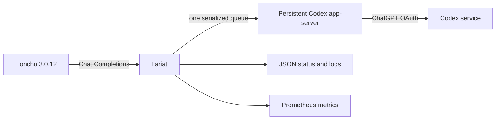

# Lariat — a self-hosted Honcho + Codex bridge

Lariat is an experimental, self-hosted bridge for people running
[Honcho](https://honcho.dev) who want to evaluate its memory, summary,
dialectic, and dream workloads with a local Codex app-server. It exposes the
small OpenAI-compatible Chat Completions surface Honcho needs and delegates
each request to Codex through a browser/device ChatGPT sign-in.

**Looking for “Honcho Codex,” “Honcho ChatGPT,” or a self-hosted Honcho OAuth
bridge?** Lariat is built for that narrow use case: a private Honcho deployment
that needs an OpenAI-shaped endpoint for Codex-backed memory processing.

> **Release status:** `0.5.0-rc.1` experimental. This is a public source
> release candidate, not a production-stability claim. Honcho 3.0.12 is the
> tested target; other Honcho 3.0.x releases are best-effort until their
> compatibility tests pass.

## Important support and security boundaries

Lariat is an independent community project. It is **not** an OpenAI product,
an official Honcho integration, or a general OpenAI API proxy. It uses the
Codex SDK's normal browser/device sign-in flow; it does not scrape cookies,
automate a browser, or call private ChatGPT web endpoints.

OpenAI documents ChatGPT sign-in for local Codex workflows and API-key
authentication for programmatic workflows. Treat Lariat as a private,
experimental self-hosting adapter: plan access, rate limits, model access, and
policy eligibility remain controlled by OpenAI and can change. For unattended
production automation, prefer an OpenAI Platform API key and a supported API
integration. See OpenAI's [Codex authentication guidance](https://learn.chatgpt.com/docs/auth).

Never expose Lariat, its device-login session, its bearer key, or the Codex
runtime to the public internet. Run it only on a trusted host and private
network.

Lariat uses the `openai-codex` Python SDK and its bundled, version-matched
Codex runtime.



## What Lariat does

- representation derivation;
- short and long summaries;
- every dialectic reasoning level;
- deduction and induction dream specialists;
- Honcho function-tool decisions and iterative tool histories;
- structured JSON and JSON Schema responses;
- Honcho's streamed final-answer path, emitted as one final SSE content chunk.

Requests are serialized to respect interactive Codex concurrency limits. The
persistent child is restarted after a transport failure and recycled safely
between requests after 50 completions or six hours by default.

## Is Lariat right for you?

Use Lariat if you are technically comfortable self-hosting Honcho, can keep a
Codex-authenticated runtime on a private machine, and want to experiment with
Honcho's memory pipeline through a Codex-compatible Chat Completions adapter.

Do not use Lariat as a way to expose Codex to other people, as a multi-tenant
service, or as a replacement for a supported API integration in unattended
production. It deliberately serializes requests, has interactive-account rate
limits, and may require you to sign in again when a refresh credential is
revoked.

## Quick start with Docker Compose

Linux AMD64 is the supported container platform for v0.5.

```bash
cp .env.example .env
openssl rand -hex 32
# Put that value in .env as LARIAT_API_KEY.
docker compose build
docker compose run --rm lariat auth login
docker compose up -d
```

The login command prints an official device-code URL and one-time code. Open
the URL in a browser, authorize the account, then let the command finish. OAuth
state is stored in the dedicated `lariat-codex-auth` volume.

```bash
curl -fsS http://127.0.0.1:5055/livez
curl -fsS http://127.0.0.1:5055/status \
  -H "Authorization: Bearer $LARIAT_API_KEY"
```

For source development:

```bash
python3 -m venv .venv
.venv/bin/pip install -e '.[test]'
export LARIAT_API_KEY="$(openssl rand -hex 32)"
.venv/bin/lariat auth status
.venv/bin/lariat serve
```

For a remote or headless host, open the device-login URL printed by `lariat
auth login` on a browser where you can complete the ChatGPT sign-in. Keep the
OAuth volume private and persistent so the running service can reuse its own
credential state.

## Honcho configuration

Place Lariat on the same private Docker network as Honcho and point every
Honcho LLM route at `http://lariat:5055/v1`. The exact environment variables
and a Compose service are in [docs/honcho-integration.md](docs/honcho-integration.md).

The five public model aliases are:

- `codex-deriver`
- `codex-summary`
- `codex-dialectic`
- `codex-dream-deduction`
- `codex-dream-induction`

By default all aliases use the authenticated account's Codex model and medium
reasoning. A global model override or per-alias model/reasoning profile can be
set when an account exposes suitable model names. See
[docs/configuration.md](docs/configuration.md).

## HTTP surface

| Route | Authentication | Purpose |
|---|---|---|
| `GET /livez` | none | Process liveness |
| `GET /readyz` | none | Codex child and OAuth readiness |
| `GET /health` | none | Backward-compatible readiness alias |
| `GET /v1/models` | bearer | Honcho aliases |
| `POST /v1/chat/completions` | bearer | Honcho completion traffic |
| `GET /status` | bearer | Sanitized runtime and account telemetry |
| `GET /metrics` | bearer | Prometheus metrics |

`/status`, `/metrics`, and structured logs never contain OAuth tokens, account
IDs, emails, prompts, responses, peer names, message IDs, or Codex thread IDs.
There is no call-home analytics.

## Compatibility boundaries

Lariat is a Honcho adapter, not a general OpenAI proxy. It supports text
messages, structured output, function tools, and final-only streaming. It
rejects multimodal message content and streaming tool decisions.

Honcho fields such as `temperature`, `top_p`, token limits, penalties, `seed`,
and `stop` are accepted for request compatibility but ignored because the Codex
SDK's thread API does not expose equivalent controls. Per-request
`reasoning_effort` is also ignored; configure reasoning globally or by alias.

Codex carries its own agent/runtime envelope, so reported input token counts can
be substantially larger than the visible Honcho prompt. Persistent app-server
use improves prefix caching but does not remove that fixed overhead. Dream
specialists can make several sequential calls and are the most expensive
workload.

## Operations and security

- [Configuration reference](docs/configuration.md)
- [Honcho integration](docs/honcho-integration.md)
- [Operations and Grafana examples](docs/operations.md)
- [Troubleshooting](docs/troubleshooting.md)
- [Security policy](SECURITY.md)
- [Contributing](CONTRIBUTING.md)

Lariat is licensed under Apache-2.0. Honcho is a separate AGPL-3.0 project;
Lariat interoperates with its public HTTP configuration and contains no copied
Honcho source.
